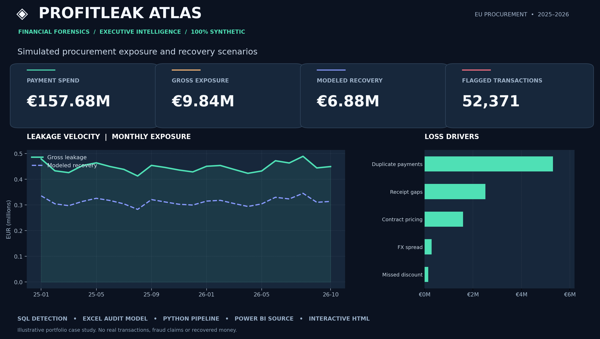

# ProfitLeak Atlas

**Procurement payment forensics and evidence-based case review**

**Python · SQL / SQLite · Advanced Excel · Power BI project source · HTML dashboard**



**[Executive dashboard](https://balbir89.github.io/ProfitLeak-Atlas/)** · **[Interactive case explorer](https://balbir89.github.io/ProfitLeak-Atlas/explore.html)** · **[Public-data quality pilot](https://balbir89.github.io/ProfitLeak-Atlas/public-data.html)** · [Excel model](excel/ProfitLeak_Atlas_Expert.xlsx)

> The corporate case study is synthetic. For local viewing, open [`docs/index.html`](docs/index.html). Hosted links activate after GitHub Pages is configured using `main` and `/docs`.

## The business question

**Where could a large organization be losing money in its procure-to-pay process—and which anomalies deserve an auditor's attention first?**

Most dashboards stop at *what happened*. ProfitLeak Atlas connects vendor terms, payment events, detection rules, risk prioritization and evidence-based case review, then models the financial implications of a potential correction.

## Executive results — fictional enterprise

| Metric | Result | What it means |
|---|---:|---|
| Procurement payments analyzed | **220,000** | Deterministically generated synthetic events |
| Payments processed | **€157.68M** | Simulated total disbursement amount |
| Potential gross exposure | **€9.84M** | Rule-based review estimate; **not established loss** |
| Modeled recoverable amount | **€6.88M** | Assumption-based scenario, **not recovered cash** |
| Flagged payment events | **52,371** | Includes nonfinancial control exceptions |
| Approval-fragmentation flags | **11,890** | Control-only; **€0 loss assigned** |
| Actual real-world recovery | **€0** | No real company payments or recoveries were investigated |

*Amounts are rounded from* [`data/marts/metrics.json`](data/marts/metrics.json). *Never interpret the simulated exposure as verified fraud or realized savings.*

## Controls and workflow

1. **Explainable exception rules.** Invoice repeats compare cumulative settlements against the authorized total. Valid installments clear the duplicate rule. Missing or conflicting authorization triggers a manual review with zero assigned exposure. Other checks cover receipt gaps, contract prices, discounts, FX spreads and approval fragmentation.
2. **Traceable SQL review records:** contract references, payment identifiers, exception reason and proposed follow-up actions for flagged cases.
3. **Python risk prioritization:** historical vendor frequency, category-normalized robust scores and temporal drift diagnostics; these are *review signals*, not calibrated fraud probabilities.
4. **Case management:** 200 seeded cases with ownership, evidence requirements, status transitions and append-only event history. Retrying a credit reference on the same case records it once.
5. **Business decision support:** nine-sheet Excel snapshot, formula-driven recovery scenarios, a mobile overview and an interactive explorer with case filters.
6. **Reproducible engineering:** parameterized synthetic data, SQL transformations, automated regressions and report-source consistency checks.

## Analytical workflow

```text
Synthetic payment events + vendor/contract master data
                         |
                SQL validation & joins
                         |
           Rule-based exception detection
                         |
       Explainable Python risk prioritization
                         |
     Financial exposure & recovery assumptions
                         |
           Analyst audit case management
                         |
          Excel | HTML | Power BI source
```

## Evidence and quality, without exaggerated claims

| Check | Result | Boundary |
|---|---|---|
| Automated regression and integration tests | **66/66 passed** | Full 220,000-payment release |
| Core SQLite performance | **8.22 s → 6.59 s** | Median of three runs per release at 220k payments, identical headline totals |
| Core SQLite scale check | **30.18 s for 1 million payments** | Single local run on generated data |
| Synthetic settlement validation | **450 → 0 false excess flags** | 2,550 designed settlements. 300 ambiguous follow-ups carried €0 exposure |
| Power BI project source structural checks | **84/84 passed** | Not a Windows Power BI Desktop execution test |
| Synthetic amount outlier challenge | **48.04% precision, 49.49% recall** | Amount-only screen on 1,500 constructed payments |
| Public City of Chicago payment-data pilot | **44 records**, including **5 aggregate rows** | Data-quality/format screening only; not fraud accuracy |
| Power BI `.pbix` file | **Not provided** | PBIP/PBIR/TMDL sources require opening in Windows Desktop |

[Settlement and performance tests](docs/settlement_validation.md) · [Public validation methodology](docs/real_world_data_validation.md) · [Model limitations](docs/expert_model_card.md) · [Power BI verification](docs/powerbi_verification.md)

## Navigate the project

| Resource | File or folder |
|---|---|
| Mobile executive demo | [`docs/index.html`](docs/index.html) (also [`dashboard/ProfitLeak_Atlas_Expert_iPhone.html`](dashboard/ProfitLeak_Atlas_Expert_iPhone.html)) |
| Searchable case explorer and recovery calculator | [`docs/explore.html`](docs/explore.html) |
| Excel financial model and audit workflow | [`excel/ProfitLeak_Atlas_Expert.xlsx`](excel/ProfitLeak_Atlas_Expert.xlsx) |
| Detection rules and transformation queries | [`sql/`](sql/) |
| Synthetic data generator and end-to-end jobs | [`src/`](src/) |
| Power BI three-page project source | [`powerbi/ProfitLeak_Atlas_PBIP/`](powerbi/ProfitLeak_Atlas_PBIP/) |
| Case exports and financial marts | [`data/marts/`](data/marts/) |
| Automated tests + GitHub CI | [`tests/`](tests/) and [`.github/workflows/ci.yml`](.github/workflows/ci.yml) |
| Public source pilot & provenance | [`data/public/`](data/public/) |
| Detailed assumptions, dictionary and checks | [`docs/`](docs/) |

## Run it locally

Requires **Python 3.11+**. The analytical rebuild uses the standard library and SQLite. From the repository root:

```bash
python src/rebuild.py --rows 220000 --seed 20261115
python -m unittest discover -s tests -v
```

The rebuild regenerates the synthetic inputs, marts, benchmark fixtures, Power BI source and web demos. Excel and the README preview are bundled snapshots of the full release. The project keeps recurring benchmark timing runs and working case databases outside the bundle.

To try the case workflow, run `python src/case_workflow.py init` then `python src/case_workflow.py --help`. The workflow database is separate from the temporary case database used to generate release snapshots. See the [example investigation](docs/settlement_validation.md#try-the-investigation-workflow).

**Power BI:** Open [`ProfitLeak_Atlas.pbip`](powerbi/ProfitLeak_Atlas_PBIP/ProfitLeak_Atlas.pbip) in Power BI Desktop on Windows and complete the [manual verification checklist](docs/powerbi_verification.md). Offline checks do **not** prove that all native report visuals render correctly.

## Responsible interpretation

This is a **portfolio demonstrator**, not a production fraud detection system. The financial scenario is synthetic. The Chicago payment records are public, curated, non-random and used only to test basic data-quality compatibility. Independent confirmed fraud labels, settlement evidence, real recovered cash, live ERP integrations and Windows Desktop validation are **not** part of the delivered work.

**Portfolio owner:** [Balbir Singh](https://github.com/Balbir89) · [How to publish this repo](docs/GITHUB_PUBLISH_GUIDE.md)
